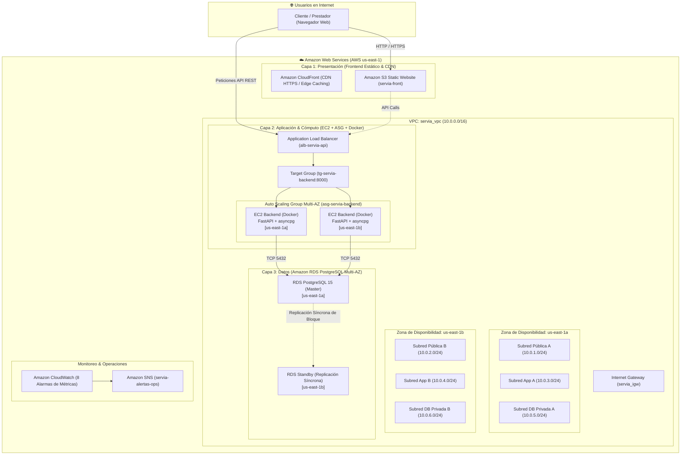

# 🏛️ ServIA — Arquitectura Cloud en Amazon Web Services (AWS)

Documentación técnica de la infraestructura en la nube desplegada para la plataforma **ServIA** (Marketplace de servicios para Valledupar, Colombia).

La solución implementa una **Arquitectura Empresarial en 3 Capas (3-Tier Architecture)** con **Alta Disponibilidad Multi-AZ** (Multi-Availability Zone), tolerancia a fallos, auto-escalado dinámico y monitoreo continuo sobre **AWS Academy Learner Lab**.

---

## 📐 Diagrama General de Arquitectura



---

## 🧱 Desglose Detallado de las 3 Capas

### 1. Capa de Presentación (Frontend)
* **Tecnología:** React Native para Web / Expo Web SPA (Single Page Application).
* **Almacenamiento Estático:** **Amazon S3** (`servia-front-<AccountId>`) configurado como *Static Website Hosting*.
* **Enrutamiento SPA:** Soporte para rutas de navegación cliente (`/login`, `/register`, `/client`, `/professional`, `/services`, etc.) mediante redirección y duplicación de `index.html`.
* **Distribución:** **Amazon CloudFront** como Content Delivery Network (CDN) con compresión Gzip/Brotli, caché perimetral global y redirección automática HTTP a HTTPS.

### 2. Capa de Aplicación (Backend y Cómputo)
* **Tecnología:** API REST Monolítica desarrollada en **FastAPI** (Python 3.11), validación con **Pydantic v2** y ORM asíncrono **SQLAlchemy** con driver **asyncpg**.
* **Contenedores:** Totalmente contenerizado en **Docker**, garantizando portabilidad e inmutabilidad en despliegues.
* **Balanceador de Carga:** **Application Load Balancer (ALB)** público (`alb-servia-api`), distribuido en dos subredes públicas para recibir el tráfico de internet en el puerto 80.
* **Chequeo de Salud (Health Checks):** Target Group (`tg-servia-backend`) monitoreando `/health` cada 15 segundos con umbral de 2 éxitos para declarar una instancia *Healthy*.
* **Auto Scaling Group (ASG):** `asg-servia-backend` distribuido en **2 Zonas de Disponibilidad** (`us-east-1a` y `us-east-1b`):
  * **Capacidad Mínima:** 2 instancias.
  * **Capacidad Deseada:** 2 instancias (garantiza al menos 1 servidor activo por AZ).
  * **Capacidad Máxima:** 4 instancias.
  * **Política de Escalado Dinámico:** *Target Tracking Scaling Policy* basada en uso promedio de CPU (`ASGAverageCPUUtilization` al 70%).
* **Launch Template:** `lt-servia-backend` sobre instancias `t3.small` con Amazon Linux 2023. Su script `UserData` automatiza:
  1. Instalación y habilitación del motor Docker.
  2. Descarga del código fuente bundle desde S3 (`servia-deploy-<AccountId>`).
  3. Espera activa (*polling*) hasta que Amazon RDS esté disponible y acepte conexiones en el puerto 5432.
  4. Ejecución del script `init.sql` (crea tipos ENUM, 8 tablas relacionales y siembra las 27 categorías de Valledupar con IDs deterministas).
  5. Construcción de la imagen Docker y lanzamiento del contenedor con reinicio automático (`--restart always`).

### 3. Capa de Datos (Base de Datos Relacional)
* **Servicio:** **Amazon RDS para PostgreSQL 15** (instancia `servia-db-rds`, clase `db.t3.micro`, almacenamiento de 20 GB gp3).
* **Alta Disponibilidad Multi-AZ:** Despliegue con réplica física síncrona:
  * **Instancia Primaria:** Ubicada en la subred de datos privada de `us-east-1a`.
  * **Instancia Standby:** Ubicada en la subred de datos privada de `us-east-1b`.
  * En caso de falla del centro de datos primario, AWS realiza un *failover* automático y transparente hacia la réplica secundaria en menos de 60 segundos sin pérdida de datos.
* **Seguridad Estricta:** La base de datos es **completamente privada** (`--no-publicly-accessible`). No tiene salida a internet ni IP pública.

---

## 🌐 Diseño de Red y Seguridad (VPC)

Toda la infraestructura se aloja dentro de una Virtual Private Cloud aislada:

* **VPC:** `servia_vpc` (`10.0.0.0/16`) con soporte y resolución DNS habilitados.
* **Segmentación en 6 Subredes (3 capas × 2 Zonas de Disponibilidad):**

| Capa | Subred | CIDR | Zona de Disponibilidad | Tipo | Propósito |
|---|---|---|---|---|---|
| **Capa 1** | `servia_sub_pub_a` | `10.0.1.0/24` | `us-east-1a` | Pública | Ingress del ALB |
| **Capa 1** | `servia_sub_pub_b` | `10.0.2.0/24` | `us-east-1b` | Pública | Ingress del ALB |
| **Capa 2** | `servia_sub_app_a` | `10.0.3.0/24` | `us-east-1a` | Pública / App | Instancias EC2 (ASG) |
| **Capa 2** | `servia_sub_app_b` | `10.0.4.0/24` | `us-east-1b` | Pública / App | Instancias EC2 (ASG) |
| **Capa 3** | `servia_sub_db_a`  | `10.0.5.0/24` | `us-east-1a` | Privada estricta | Amazon RDS Primario |
| **Capa 3** | `servia_sub_db_b`  | `10.0.6.0/24` | `us-east-1b` | Privada estricta | Amazon RDS Standby |

### Grupos de Seguridad (Security Groups) — Principio de Menor Privilegio

```
[ Internet: 0.0.0.0/0 ]
         │
         │ HTTP (80)
         ▼
[ sg_servia_alb ] ──── Ingress: 0.0.0.0/0:80
         │
         │ HTTP (8000)
         ▼
[ sg_servia_ec2 ] ──── Ingress: sg_servia_alb:8000 (y SSH :22)
         │
         │ PostgreSQL (5432)
         ▼
[ sg_servia_rds ] ──── Ingress: EXCLUSIVAMENTE sg_servia_ec2:5432
```

1. **`sg_servia_alb`**: Solo acepta tráfico web HTTP (puerto 80) desde internet.
2. **`sg_servia_ec2`**: Acepta conexiones en el puerto 8000 originadas **únicamente** desde el grupo de seguridad del ALB.
3. **`sg_servia_rds`**: El puerto 5432 está cerrado para internet y solo acepta paquetes provenientes del grupo de seguridad de las instancias EC2 (`sg_servia_ec2`).

---

## 📊 Monitoreo y Notificaciones (Amazon CloudWatch & SNS)

La arquitectura incluye 8 alarmas de métricas conectadas a un tópico **Amazon SNS** (`servia-alertas-ops`):

| # | Alarma CloudWatch | Métrica Evaluada | Umbral de Disparo | Acción |
|---|---|---|---|---|
| 1 | `servia-asg-cpu-alta` | `AWS/EC2: CPUUtilization` | Promedio > 80% (3 min) | Notificación SNS |
| 2 | `servia-asg-cpu-baja` | `AWS/EC2: CPUUtilization` | Promedio < 10% (15 min) | Notificación SNS |
| 3 | `servia-rds-cpu-alta` | `AWS/RDS: CPUUtilization` | Promedio > 75% (3 min) | Notificación SNS |
| 4 | `servia-rds-disco-bajo` | `AWS/RDS: FreeStorageSpace`| Menos de 2 GB libres | Notificación SNS (Crítica) |
| 5 | `servia-rds-conexiones-altas`| `AWS/RDS: DatabaseConnections`| > 80 conexiones activas | Notificación SNS |
| 6 | `servia-alb-errores-5xx` | `AWS/ApplicationELB: HTTPCode_ELB_5XX_Count` | > 10 errores en 1 min | Notificación SNS |
| 7 | `servia-alb-latencia-alta` | `AWS/ApplicationELB: TargetResponseTime` | Latencia > 3 seg | Notificación SNS |
| 8 | `servia-alb-hosts-bajos` | `AWS/ApplicationELB: HealthyHostCount` | Menos de 2 servidores sanos | Notificación SNS (Crítica) |

---

## 🚀 Automatización del Despliegue

La solución es **100% autónoma** y se gestiona con scripts de PowerShell idempotentes:

```
ServIA/
├── credentials.ps1            # Carga credenciales STS de Learner Lab y auto-sincroniza
├── deploy_s3.ps1              # Despliegue completo en 8 fases
├── destroy_s3.ps1             # Destrucción controlada y limpieza de recursos
├── fix_asg_policy.ps1         # Script de utilidad para refrescar políticas ASG
├── BACKEND/                   # Código de la API FastAPI y Dockerfile
└── FRONTEND ESTE SI/          # Código de la aplicación Expo Web
```

### Instrucciones de Uso

#### 1. Cargar Credenciales de AWS Academy
Abre [`credentials.ps1`](credentials.ps1) y pega el bloque obtenido en **AWS Details ➔ AWS CLI**. Luego ejecuta:
```powershell
.\credentials.ps1
```

#### 2. Desplegar toda la Infraestructura
```powershell
.\deploy_s3.ps1
```
*El script crea la VPC, subredes, SGs, base de datos RDS Multi-AZ, compila el código, levanta el Auto Scaling Group con Docker, publica el frontend en S3 y CloudFront, y valida los health checks de la API.*

#### 3. Destruir y Liberar Recursos
```powershell
.\destroy_s3.ps1
```
*Elimina de forma ordenada los grupos de auto-escalado, balanceadores, distribuciones, vacía los buckets S3, elimina la base de datos RDS sin snapshot de cobro, y libera las subredes y la VPC.*

---

## 📌 Resumen de Cumplimiento de Requisitos

* ✅ **Arquitectura en 3 Capas:** Presentación (S3/CloudFront), Aplicación (EC2 ASG + Docker), Datos (RDS PostgreSQL).
* ✅ **Eliminación Total de Dependencias Externas:** Supabase eliminado al 100%; migrado a PostgreSQL nativo.
* ✅ **Alta Disponibilidad Multi-AZ:** ASG repartido en `us-east-1a` y `us-east-1b` (min=2, desired=2); RDS Multi-AZ sincrónico.
* ✅ **Seguridad por Capas:** Subredes públicas para ALB, subredes privadas para datos, SGs encadenados por referencia.
* ✅ **Compatibilidad AWS Learner Lab:** Detección de token de sesión STS, compatibilidad con `LabInstanceProfile`, manejo de cuotas de EIP y políticas de expiración.
